# 🔔 Antigravity Glassmorphism Toast Notifier

<p align="center">
  
</p>

<p align="center">
  <b>Sleek, Linear/Raycast-style Glassmorphism Desktop Toasts with Custom Luxury Audio Chimes</b><br>
  <i>Элегантные всплывающие стеклянные уведомления для Windows с кастомным звуком</i>
</p>

<p align="center">
  <a href="#russian">🇷🇺 Читать на русском</a> • <a href="#english">🇬🇧 English Readme</a>
</p>

<p align="center">
  <a href="https://github.com/storm-dev-arch/antigravity-notifier/releases"></a>
  
  
  
  
</p>

---

<a name="russian"></a>
## 🇷🇺 Документация на русском

### ✨ Возможности
- **💎 Glassmorphism UI (Raycast / Linear)**:
  - Глубокий темный стеклянный фон с эффектом прозрачности (`rgba(15, 20, 28, 0.95)`).
  - Тонкая рамка с градиентом и мягким свечением.
  - Никаких лишних смайликов и AI-слопа — чистая типографика и оригинальный логотип.
- **🎬 Плавная анимация на 60 FPS**:
  - Кубическая кривая скольжения (`OutCubic`) длительностью 320ms из правого нижнего угла экрана.
  - Автоматическое плавное скрытие через 4.5 секунды (или кликом по карточке).
- **🔊 Кастомный звук уведомления**:
  - Воспроизведение через встроенный `PyQt6.QtMultimedia` (поддержка `sound.mp3` и `chime.wav`).
  - Мгновенный отклик без задержек.
- **🛡️ Защита от дублей (Debounce Lock)**:
  - Встроенный 2.5-секундный мьютекс предотвращает повторные всплытия, если несколько процессов вызывают тост одновременно.
- **🛠️ Автономный CLI**:
  - Можно использовать в любых своих скриптах, играх или задачах автоматизации.

### 🚀 Быстрый старт

#### 1. Установка
```bash
git clone https://github.com/storm-dev-arch/antigravity-notifier.git
cd antigravity-notifier
pip install -r requirements.txt
```

#### 2. Запуск одного уведомления
```bash
python toast.py "Заголовок" "Генерация ответа завершена!"
```

#### 3. Фоновый наблюдатель за Antigravity
Запусти `run_silent.vbs` — скрипт начнет бесшумно в фоне следить за базой Antigravity и выдавать уведомление при каждом завершении ответа.

---

<a name="english"></a>
## 🇬🇧 English Documentation

### ✨ Features
- **💎 Linear / Raycast Aesthetic**:
  - Dark obsidian glassmorphism card with precision borders and subtle ambient glow.
  - Zero emojis or AI-slop graphics — staff-grade typography and branding.
- **🎬 60 FPS Cubic Animation**:
  - Snappy 320ms slide-in from bottom-right corner using `QEasingCurve.Type.OutCubic`.
  - Auto-fade after 4.5 seconds with pause-on-hover capability.
- **🔊 Custom Audio Playback**:
  - Native playback of `sound.mp3` or `chime.wav` via `PyQt6.QtMultimedia`.
- **🛡️ Hardware Debounce Lock**:
  - Built-in 2.5-second mutex lock preventing duplicate toasts across multiple callers.
- **🛠️ Standalone CLI**:
  - Plug-and-play notification utility for any Windows workflow.

### 🚀 Quick Start
```bash
git clone https://github.com/storm-dev-arch/antigravity-notifier.git
cd antigravity-notifier
pip install -r requirements.txt
python toast.py "Google Antigravity" "Turn generation complete!"
```

---

## 📄 License
Distributed under the MIT License. See `LICENSE` for details.
